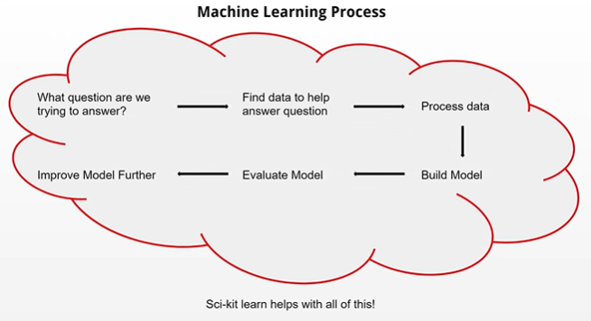
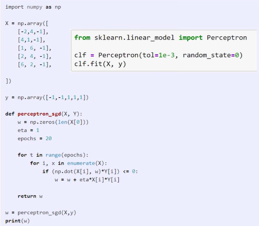
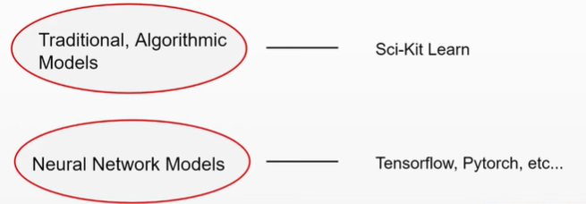
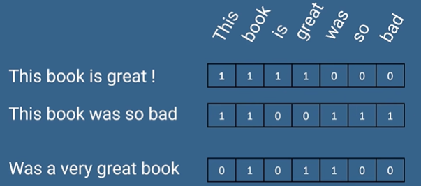

# sklearn
Data &amp; Code associated with my tutorial on the sci-kit learn machine learning library in python

Video link: https://youtu.be/M9Itm95JzL0

Tutorial.ipynb is the file that I worked on during the video.

Data directory contains several files of 1000+ amazon reviews across different departments. If you want the raw data that I created these files from, check out here: http://jmcauley.ucsd.edu/data/amazon/

## Bag of Words model
